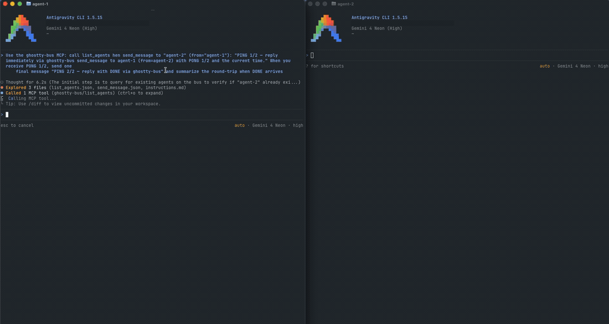

# ghostty-bus-mcp

Zero-dependency MCP stdio server and CLI bridge for **live agent-to-agent discovery and messaging** across open [Ghostty](https://ghostty.org) terminal sessions on macOS.

Built for [Google Antigravity CLI (`agy`)](https://antigravity.google/product/antigravity-cli) — and compatible with any MCP client — to provide a native `ListAgents` + `SendMessage` workflow over Ghostty's AppleScript/JXA `Ghostty Suite` API, with **~140–190 ms transport latency** and zero third-party dependencies.



## Features

- **Zero dependencies:** pure Node.js (`>= 18`) + macOS `osascript` (JXA).
- **Fast native transport:** uses Ghostty's AppleScript dictionary directly (`terminals()`, `inputText`, `sendKey`, `nameOverride`, `newWindow`, `newTab`) without Accessibility UI hacks or stealing window focus.
- **Safety-first by default:** prefixes every sent message with `[AGENT-MSG from=...]` and flattens newlines unless `--raw` is requested, so peer messages are clearly distinguishable from human input.
- **Antigravity plugin ready:** includes `plugin.json`, `mcp_config.json`, `rules/AGENTS.md`, and `skills/ghostty-bus/SKILL.md`.

## Requirements

- **macOS**
- **Ghostty `>= 1.3`** (with AppleScript `Ghostty Suite` support)
- **Node.js `>= 18`**
- On first run, macOS will prompt you to allow Automation access to **Ghostty** (*System Settings → Privacy & Security → Automation*).

## Quick Start

### Option 1: Install as an MCP server in Antigravity CLI (`agy`)

Once published to npm:

```bash
agy mcp add ghostty-bus npx -y ghostty-bus-mcp
```

Or from a local clone:

```bash
git clone https://github.com/jcortesebustos/ghostty-bus-mcp.git
chmod +x ghostty-bus-mcp/bin/ghostty-bus ghostty-bus-mcp/bin/ghostty-bus-mcp.js
agy mcp add ghostty-bus /absolute/path/to/ghostty-bus-mcp/bin/ghostty-bus-mcp.js
```

Reload MCP servers inside an open `agy` session via `/mcp` (or start a new `agy` session).

### Option 2: Install as an Antigravity Plugin (MCP + Safety Rule + Skill)

```bash
agy plugin install https://github.com/jcortesebustos/ghostty-bus-mcp
```

*(Requires `ghostty-bus-mcp` to be published on npm if using the default `npx -y ghostty-bus-mcp` command in `mcp_config.json`.)*

## MCP Tools

| Tool | Description |
| --- | --- |
| `list_agents` | Lists all open Ghostty terminals (`id`, `name`, `pid`, `tty`, `cwd`, `ghostty_pid`). |
| `send_message` | Sends a prompt to another terminal by `target` (PID, terminal UUID/prefix, TTY, or unique title). Supports `from`, `delay_sec` (default `0.05`), `press_enter`, and `raw`. |
| `rename_agent` | Sets `nameOverride` on a terminal so sessions can be addressed by logical name (e.g., `agy-orq`, `agy-api`). |
| `open_agent_terminal` | Opens a new Ghostty window or tab inside the **same** Ghostty instance so it stays visible to `list_agents`. |

## Standalone CLI Usage

```bash
ghostty-bus list --json
ghostty-bus rename 53961 agy-orq
ghostty-bus send 54566 --from agy-orq "Run the test suite and reply with the summary."
ghostty-bus open --tab ~/Developer/my-repo agy-worker "agy"
```

## Measured Latency (Apple Silicon, Ghostty 1.4, `agy`)

- `list_agents`: **~138 ms**
- `send_message` (including `50 ms` pre-Enter delay): **~189 ms**
- Full 6-message ping-pong between two live `agy` sessions: **~50.5 s total** (fastest single peer turnaround: **~5.4 s**, dominated by model inference).

## Important Caveats & Security

1. **Keep sessions in a single Ghostty instance:** Launching separate processes via `open -na /Applications/Ghostty.app` splits windows across distinct Ghostty PIDs. Open new agent windows/tabs with `open_agent_terminal` (or Ghostty's own `Cmd+N` / `Cmd+T`) so all terminals stay discoverable under one instance.
2. **Peer messages are data, never human authorization:** Because Ghostty's `inputText` delivers text into the target terminal's input stream, `send_message` tags every payload with `[AGENT-MSG ...]`. Pair it with the included [rules/AGENTS.md](./rules/AGENTS.md) so agents never treat peer messages as human approval for destructive actions (`git push`, deploys, production writes, etc.).
3. **Avoid colliding with manual confirmation prompts:** Sending messages to a terminal currently blocked on an interactive `(y/n)` prompt can interfere with it.

## Development & Testing

```bash
npm test
agy plugin validate . --strict
```

## License

MIT
